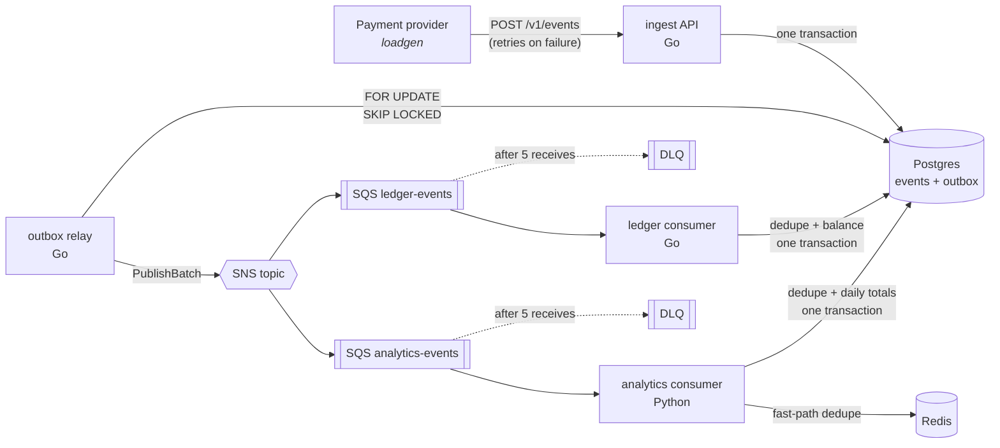

# event-pipeline

[](https://github.com/learnercys/event-pipeline/actions/workflows/ci.yml)

An event-ingestion pipeline for payment webhooks, built to show **exactly-once
effects on top of at-least-once delivery**. It's written in Go and Python on
Postgres, SQS/SNS and Redis.

Duplicates, crashes and redeliveries aren't edge cases here. A chaos test
injects them on purpose, SIGKILLs services, and restarts Postgres under load.
Then it proves every account balance is still exact to the cent.

```
$ make chaos
==> sending 1500 events (run chaos_20261113T062830)
==> SIGKILL relay ledger-consumer analytics-consumer
==> restarting postgres under load
==> SIGKILL relay analytics-consumer
sent 1500 unique events as 1968 requests (+333 retries) in 9.301s
==> SIGKILL ledger-consumer
run chaos_20261113T062830: 1500 events, 5 poison messages, settled check after 58s

   INVARIANT                                     GOT             WANT
✅  every unique event stored exactly once        1500            1500
✅  outbox fully published                        0               0
✅  ledger: each event processed exactly once     1500            1500
✅  analytics: each event processed exactly once  1500            1500
✅  ledger: balances match                        no differences  no differences
✅  analytics: daily totals match                 no differences  no differences
✅  analytics: event count matches                1500            1500
✅  ledger: poison messages in DLQ                5               5
✅  ledger: unapplied events in DLQ               0               0
✅  ledger: applied events also in DLQ (info)     0               any
✅  analytics: poison messages in DLQ             5               5
✅  analytics: unapplied events in DLQ            0               0
✅  analytics: applied events also in DLQ (info)  0               any

PASS: every event was applied exactly once by every consumer
```

## Architecture



| Component | Language | Job |
|---|---|---|
| `cmd/ingest` | Go | Validates events and stores event + outbox row in one transaction. Returns `201` when new, `200` on a duplicate, `409` when an ID is reused with different data. |
| `cmd/relay` | Go | Publishes outbox rows to SNS in batches and marks them published. Safe to run as several replicas. |
| `cmd/ledger-consumer` | Go | Applies events to account balances, exactly once. Uses a worker pool and a circuit breaker. |
| `analytics/` | Python | Builds daily totals per account, exactly once, with Redis as a dedupe cache. |
| `cmd/loadgen` | Go | Acts like a provider: duplicates, retries, poison messages. Writes the expected end state. |
| `cmd/verify` | Go | Waits for the pipeline to settle and checks every invariant against the expected state. |

## How each failure is handled

| What goes wrong | Where it's injected | Why the result is still correct |
|---|---|---|
| Provider retries a webhook | `loadgen` re-sends ~30% of events | `INSERT … ON CONFLICT (id) DO NOTHING`: the retry gets `200 duplicate` |
| Commit succeeds but the response is lost | `ingest.fail_after_commit` | Same as above: the client's retry is a duplicate, never a second event |
| Write to DB *and* broker, crash in between | — | [Transactional outbox](docs/adr/0001-transactional-outbox.md): one DB transaction, published later |
| Relay crashes after publishing, before marking | `relay.crash_after_publish` + SIGKILL | Rows stay unpublished and get republished. Consumers dedupe. |
| Consumer crashes after commit, before ack | `ledger/analytics.crash_after_commit` + SIGKILL | [Dedupe row and effect in one transaction](docs/adr/0002-idempotent-consumers.md), so the redelivery is a no-op |
| Events arrive out of order | SQS standard queues | [State is commutative](docs/adr/0003-commutative-state.md) (`balance += amount`), so order doesn't matter |
| Malformed "poison" message | `loadgen` publishes 5 straight to SNS | Never acked, so the redrive policy moves it to the DLQ after 5 receives |
| Postgres restarts under load | `docker compose restart postgres` | Ingest returns `503` and the client retries. Consumers trip a **circuit breaker** and stop receiving, so valid messages don't burn their redrive attempts. |
| Redis loses keys or goes down | — | [Redis is only a cache](docs/adr/0004-redis-fast-path-dedupe.md), written *after* the commit. Postgres decides. |

The circuit breaker exists because the first chaos run failed. Consumers kept
polling during the Postgres restart, and each failed attempt counted toward
the DLQ threshold, so valid events were dead-lettered. The verifier now checks
that **no unapplied event ever reaches a DLQ**.

## Run it

You need Docker, Go 1.27+, and [uv](https://docs.astral.sh/uv/) for the
Python tests. No AWS account: SNS and SQS run locally on
[Moto](https://github.com/getmoto/moto).

```bash
make up       # Postgres, Redis, Moto and all services
make send     # post one event with curl
make load     # 1,000 events, no chaos, then verify
make chaos    # the full chaos test (fresh stack, about 1–2 minutes)
make test     # Go and Python unit tests, no Docker needed
make down
```

API: `POST localhost:58080/v1/events`

```json
{"id": "evt_123", "type": "payment.captured", "account_id": "acct_1",
 "amount_cents": 2500, "currency": "USD", "occurred_at": "2026-11-13T10:00:00Z"}
```

`type` is `payment.captured` or `refund.issued`. Refunds subtract from the
balance.

## Numbers

Ingest API with no chaos: 5,000 unique events sent as 6,509 requests (30% are
duplicates).

| Concurrent clients | Throughput | p50 | p95 | p99 |
|---|---|---|---|---|
| 16 | 7,900 req/s | 1.95 ms | 3.01 ms | 3.75 ms |
| 64 | 8,500 req/s | 7.20 ms | 9.46 ms | 18.9 ms |

Apple M2 Max, everything in Docker Desktop, Postgres with default durability
settings (`synchronous_commit=on`). These numbers are for the ingest API, which
is bound by Postgres commits. Moto is a functional emulator, not a performance
one: it slows down noticeably past a few thousand queued messages. That's why
the chaos test uses 1,500 events, and why downstream throughput isn't
reported. Real SQS doesn't have that limit.

## Tests

| Layer | What it covers |
|---|---|
| Go unit tests | Validation, HTTP status codes, lost response then retry, SNS batch splitting, partial batch failure, crash-after-commit redelivery, circuit breaker |
| Python unit tests | Decoding, cache hit skips the DB, Redis down falls back to Postgres, failed commit never marks the cache, circuit breaker |
| Postgres integration tests (`make test-integration`) | 50 concurrent retries create exactly 1 event and 1 outbox row; 20 concurrent redeliveries move the balance once; an aborted relay batch is offered again |
| Chaos test (`make chaos`) | The whole system under injected failures, SIGKILLs and a database restart, checked against independently computed totals |

All four run in [CI](.github/workflows/ci.yml).

## Project layout

```
cmd/                 one binary per service (ingest, relay, ledger-consumer,
                     bootstrap, loadgen, verify)
internal/
  event/             event model and validation
  store/             Postgres: ingest + outbox, relay batches, ledger
  ingest/            HTTP handler
  relay/             outbox → SNS
  consumer/          SQS worker pool, dedupe, circuit breaker
  chaos/             failure injection (CHAOS="point=probability,…")
  verify/            invariants for the chaos test
analytics/           Python consumer (uv, psycopg, boto3, redis)
migrations/          schema
docs/adr/            design decisions
scripts/chaos.sh     the chaos scenario
```

## What I'd change for production

- **Infrastructure as code.** Terraform for SNS, SQS, DLQs, queue policies and
  IAM instead of `cmd/bootstrap`. That's planned for a separate platform repo.
- **Observability.** OpenTelemetry traces that follow one event from the HTTP
  request through SNS and SQS to both consumers. Prometheus metrics for outbox
  lag, queue age, DLQ depth and breaker state, with alerts on DLQ depth > 0.
- **Outbox and dedupe retention.** Delete published outbox rows and old
  `processed_messages` rows on a schedule, or partition both by day and drop
  old partitions.
- **CDC instead of polling.** Logical replication (Debezium) would remove the
  polling delay and load on the outbox table.
- **Migrations.** A migration tool (goose or golang-migrate) instead of
  `docker-entrypoint-initdb.d`.
- **DLQ tooling.** A redrive command that replays dead-lettered messages once
  the bug is fixed. That's safe because every consumer is idempotent.
